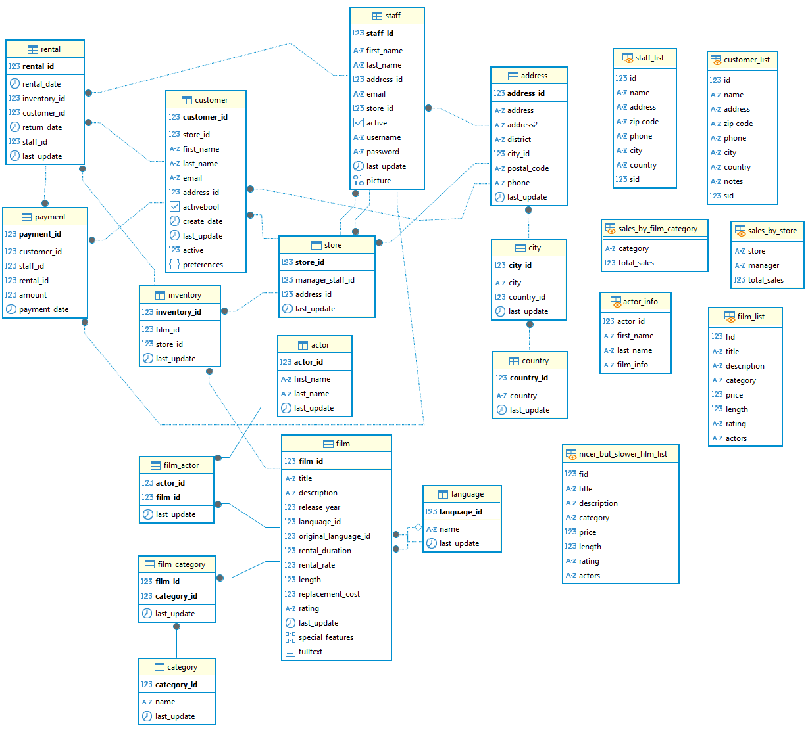
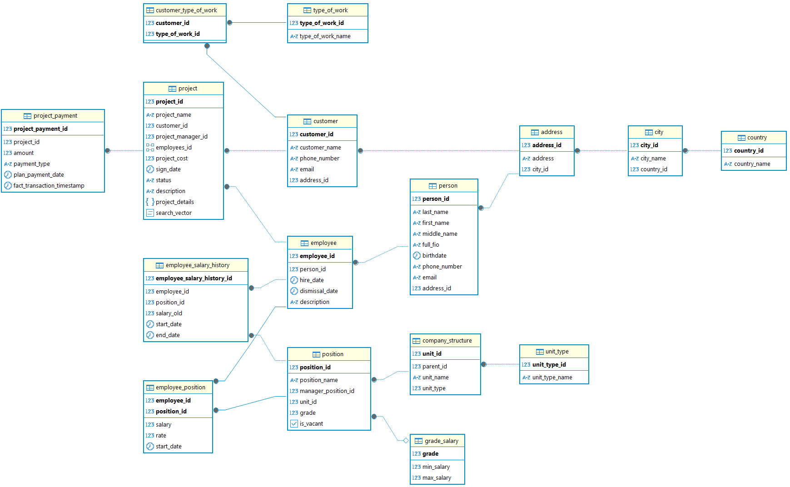

# PostgreSQL 18 с предустановлеными базами stroy и dvd-rental

Учебная сборка PostgreSQL 18 в Docker с двумя предзагруженными датасетами.
Используется на семинарах и для выполнения домашних заданий.

## Что внутри

- Официальный образ **PostgreSQL 18** (`postgres:18`).
- Два SQL-датасета, которые автоматически загружаются при первом запуске контейнера:
  - `dvd_rental`
  - `stroy`
- Всё лежит в одной базе `postgres`.

```
.
├── docker-compose.yml
├── README.md
└── initdb/
    ├── dvd-rental_custom.sql
    └── stroy26.sql
```

## Требования

- Установленный [Docker Desktop](https://www.docker.com/products/docker-desktop/) (Windows / macOS) или Docker Engine (Linux).
- Запущенный Docker Desktop перед первым использованием.

</br>

<details>

<summary><b>Быстрый старт</b></summary>

## Быстрый старт

### 1. Получите файлы репозитория

Вариант А — клонировать через git:

```bash
git clone <https://github.com/NKhashchanov/psql18_stroy_dvd_rental.git>
cd <psql18_stroy_dvd_rental>
```

Вариант Б — скачать репозиторий как ZIP и распаковать, либо просто скопировать
папку с файлами `docker-compose.yml` и `initdb/` в удобное место.

### 2. Запустите контейнер

Откройте терминал в папке с `docker-compose.yml` и выполните:

```bash
docker compose up -d
```

При первом запуске Docker:
- скачает образ `postgres:18` (может занять пару минут);
- создаст том `pgdata` для хранения данных;
- выполнит оба SQL-файла из `initdb/` — датасеты загрузятся автоматически.

Проверить, что всё запустилось:

```bash
docker compose ps
```

Вы должны увидеть контейнер `study_db` в статусе `running` (или `healthy`).

### 3. Подключитесь к базе

Параметры подключения (одинаковые для терминала, DBeaver, DataGrip, pgAdmin и любого другого клиента):

| Параметр | Значение |
|---|---|
| **Host** | `localhost` |
| **Port** | `5432` |
| **Database** | `postgres` |
| **User** | `postgres` |
| **Password** | `postgres` |

Проверка из терминала (без установки GUI-клиента):

```bash
docker exec -it study_db psql -U postgres -d postgres
```

Внутри `psql` можно посмотреть список таблиц командой `\dt`.

### 4. Остановка

```bash
docker compose down
```

Данные при этом **сохраняются** в томе `pgdata` — при следующем `docker compose up -d`
всё будет на месте.

## Изменение порта

Если порт **5432** на вашей машине уже занят (например, локальным PostgreSQL),
контейнер не сможет запуститься. Решение — сменить порт на хосте.

Создайте в корне репозитория файл `.env` со строкой:

```env
POSTGRES_PORT=5433 # или любой иной свободный порт
```

После этого перезапустите контейнер:

```bash
docker compose down
docker compose up -d
```

И подключайтесь к `localhost:5433` вместо `localhost:5432`.
Пароль и пользователь остаются прежними.

## Сброс к исходному состоянию

Если нужно вернуть базу к «чистому» виду (перезалить датасеты заново,
удалить все изменения, сделанные в процессе работы), выполните:

```bash
docker compose down -v
docker compose up -d
```

Флаг `-v` удаляет том с данными — при следующем запуске скрипты из `initdb/`
выполнятся заново.

> ⚠️ **Важно:** SQL-файлы из `initdb/` запускаются **только при создании нового тома**.
> Обычный `docker compose restart` или `docker compose down` без `-v` их не перезапустит.

## Технические заметки

- В PostgreSQL 18 официальный образ ожидает том в `/var/lib/postgresql`
  (а не в `/var/lib/postgresql/data`, как было в версиях 17 и ниже). В `docker-compose.yml`
  уже настроено правильное монтирование — **не меняйте этот путь**, иначе данные
  будут записываться в анонимный том и пропадут при пересоздании контейнера.
- Учётные данные `postgres / postgres` предназначены исключительно для локальной
  учебной песочницы. В реальных проектах так делать нельзя.

## Что делать, если не запускается

**Ошибка `failed to connect to the docker API at npipe:////./pipe/dockerDesktopLinuxEngine`**

Docker Desktop не запущен. Откройте приложение **Docker Desktop** из меню «Пуск»,
дождитесь окончания загрузки (значок кита в трее перестанет анимироваться)
и повторите `docker compose up -d`.

**Ошибка `port is already allocated`**

Порт 5432 занят. См. раздел «Изменение порта».

**Датасеты не загрузились**

Проверьте логи инициализации:

```bash
docker compose logs postgres
```

Если в логах нет строк про выполнение `dvd-rental_custom.sql` и `stroy26.sql`,
удалите том и перезапустите с нуля: `docker compose down -v && docker compose up -d`.

</details>

</br>

<details>

<summary><b>Описание учебной базы данных dvd-rental</b></summary>

## Описание учебной базы данных dvd-rental

База данных **dvd-rental** является учебной, **не** содержит персональных или коммерческих данных, может содержать ошибки или неточности в данных.

База данных является фрагментом базы данных компании, занимающейся арендой DVD дисков.

**Диаграмма данных:**



---

### Справочники

**actor** — список актёров

- `actor_id` — идентификатор актера
- `first_name` — имя актера
- `last_name` — фамилия актера
- `last_update` — дата и время изменения записи

**city** — города

- `city_id` — идентификатор города
- `city` — название города
- `country_id` — идентификатор страны
- `last_update` — дата и время изменения записи

**address** — адреса клиентов, сотрудников и магазинов

- `address_id` — идентификатор адреса
- `address` — значение адреса
- `address2` — значение дополнительного адреса
- `district` — район
- `city_id` — идентификатор города
- `postal_code` — индекс
- `phone` — номер телефона
- `last_update` — дата и время изменения записи

**customer** — клиенты магазина

- `customer_id` — идентификатор клиента
- `store_id` — идентификатор магазина
- `first_name` — имя клиента
- `last_name` — фамилия клиента
- `email` — эмейл клиента
- `address_id` — идентификатор адреса проживания клиента
- `activebool` — флаг активности
- `create_date` — дата создания записи
- `last_update` — дата и время изменения записи
- `active` — флаг активности (целочисленный)

**category** — категории фильмов (Action, Comedy и др.)

- `category_id` — идентификатор категории
- `name` — название категории
- `last_update` — дата и время изменения записи

**country** — страны

- `country_id` — идентификатор страны
- `country` — название страны
- `last_update` — дата и время изменения записи

**film** — фильмы (карточка фильма)

- `film_id` — идентификатор фильма
- `title` — название фильма
- `description` — описание
- `release_year` — год издания
- `language_id` — язык озвучки
- `original_language_id` — оригинальный язык
- `rental_duration` — длительность аренды
- `rental_rate` — стоимость аренды
- `length` — длительность фильма
- `replacement_cost` — стоимость возмещения
- `rating` — возрастное ограничение
- `last_update` — дата и время изменения записи
- `special_features` — атрибуты фильма
- `fulltext` — поле для полнотекстового поиска

**film_actor** — связка актёров и фильмов (многие-ко-многим)

- `actor_id` — идентификатор актера
- `film_id` — идентификатор фильма
- `last_update` — дата и время изменения записи

**film_category** — связка фильмов и категорий (многие-ко-многим)

- `category_id` — идентификатор категории
- `film_id` — идентификатор фильма
- `last_update` — дата и время изменения записи

**inventory** — DVD диски с фильмами

- `inventory_id` — идентификатор диска
- `film_id` — идентификатор фильма
- `store_id` — идентификатор магазина
- `last_update` — дата и время изменения записи

**language** — языки фильмов

- `language_id` — идентификатор языка
- `name` — название языка
- `last_update` — дата и время изменения записи

**payment** — платежи за аренду

- `payment_id` — идентификатор платежа
- `customer_id` — идентификатор пользователя
- `staff_id` — идентификатор сотрудника
- `rental_id` — идентификатор аренды
- `amount` — размер платежа
- `payment_date` — дата и время платежа

**staff** — сотрудники магазина

- `staff_id` — идентификатор сотрудника
- `first_name` — имя сотрудника
- `last_name` — фамилия сотрудника
- `address_id` — идентификатор адреса проживания сотрудника
- `email` — эмейл сотрудника
- `store_id` — идентификатор магазина
- `active` — флаг активности
- `username` — логин сотрудника
- `password` — пароль сотрудника
- `last_update` — дата и время изменения записи
- `picture` — фотография сотрудника

**store** — магазины (точки проката)

- `store_id` — идентификатор магазина
- `manager_staff_id` — идентификатор сотрудника, который является менеджером магазина
- `address_id` — идентификатор адреса магазина
- `last_update` — дата и время изменения записи

**rental** — факты аренды фильмов

- `rental_id` — идентификатор аренды
- `rental_date` — дата и время аренды
- `inventory_id` — идентификатор диска
- `customer_id` — идентификатор клиента
- `return_date` — дата и время возврата диска
- `staff_id` — идентификатор сотрудника
- `last_update` — дата и время изменения записи

---

### Типы данных

**mpaa_rating** — используется в таблице `film` для обозначения возрастного рейтинга фильма (по классификации MPAA), тип данных `enum`.

Значения: `'G'`, `'PG'`, `'PG-13'`, `'R'`, `'NC-17'`

**year** — используется для хранения года выпуска фильма, тип `domain` над `integer` (ограничение: 1901–2155).

---

### Представления

**actor_info** — объединяет актёров с фильмами и категориями, в которых они участвовали.

**customer_list** — список клиентов с контактной информацией, активностью и адресом.

**film_list** — список фильмов с актёрами, категориями и языками.

**nicer_but_slower_film_list** — то же самое, что `film_list`, но в более удобном для чтения формате (с дополнительными объединениями).

**staff_list** — список сотрудников (ФИО, email, адрес, магазин).

**sales_by_film_category** — отчёт по доходам, сгруппированным по категориям фильмов.

**sales_by_store** — отчёт по доходам магазинов, с указанием управляющего.

</details>

</br>

<details>

<summary><b>Описание учебной базы данных stroy</b></summary>

## Описание учебной базы данных stroy

База данных **stroy** является учебной, **не** содержит персональных или коммерческих данных, может содержать ошибки или неточности в данных.
Названия различных сущностей сгенерированы с помощью **Chat-GPT**, остальные значения сгенерированы случайным образом средствами **SQL**.

База данных является фрагментом базы данных компании, занимающейся строительством и проектированием.

**Диаграмма данных:**



---

### Справочники

**country** — страны

- `country_id` — идентификатор страны
- `country_name` — название страны

**city** — города

- `city_id` — идентификатор города
- `city_name` — название города
- `country_id` — идентификатор страны

**address** — адреса сотрудников (физических лиц) и контрагентов

- `address_id` — идентификатор адреса
- `address` — значение адреса, в виде улицы, номера дома, номера квартиры / офиса
- `city_id` — идентификатор города

**customer** — контрагенты

- `customer_id` — идентификатор контрагента
- `customer_name` — наименование контрагента
- `phone_number` — телефон
- `email` — эмейл
- `address_id` — идентификатор адреса контрагента

**person** — физические лица

- `person_id` — идентификатор физического лица
- `last_name` — фамилия
- `first_name` — имя
- `middle_name` — отчество
- `full_fio` — вычисляемый столбец, формирует ФИО в виде одной строки
- `birthdate` — дата рождения
- `phone_number` — телефон
- `email` — эмейл
- `address_id` — идентификатор адреса регистрации

**employee** — сотрудники

- `employee_id` — идентификатор сотрудника
- `person_id` — идентификатор физического лица
- `hire_date` — дата найма
- `dismissal_date` — дата увольнения
- `description` — описание

**position** — должности (штатное расписание)

- `position_id` — идентификатор должности
- `position_name` — наименование должности
- `manager_position_id` — идентификатор прямого руководителя
- `unit_id` — идентификатор структурного подразделения
- `grade` — идентификатор зарплатной вилки
- `is_vacant` — является ли должность вакантной

**company_structure** — структура компании

- `unit_id` — идентификатор структурного подразделения
- `parent_id` — идентификатор родительского структурного подразделения
- `unit_name` — наименование структурного подразделения
- `unit_type` — идентификатор типа структурного подразделения

**unit_type** — тип структурного подразделения

- `unit_type_id` — идентификатор типа структурного подразделения
- `unit_type_name` — наименование типа структурного подразделения

**grade_salary** — зарплатная вилка должности

- `grade` — идентификатор зарплатной вилки
- `min_salary` — минимальная граница зарплатной вилки
- `max_salary` — максимальная граница зарплатной вилки

**employee_position** — связь многие ко многим между сотрудником и должностью, историчность формируется в 4 типе SCD.

- `employee_id` — идентификатор сотрудника
- `position_id` — идентификатор должности
- `salary` — текущий оклад
- `rate` — коэффициент ставки
- `start_date` — дата, с которой актуален оклад сотрудника по данной должности

**type_of_work** — тип работ, заказываемый контрагентом

- `type_of_work_id` — идентификатор типа работ
- `type_of_work_name` — наименование заказываемых работ

**customer_type_of_work** — связь многие ко многим между контрагентом и типом работ

- `customer_id` — идентификатор контрагента
- `type_of_work_id` — идентификатор типа работ

**project** — проекты

- `project_id` — идентификатор проекта
- `project_name` — название проекта
- `customer_id` — идентификатор контрагента
- `project_manager_id` — идентификатор сотрудника (руководителя проекта)
- `employees_id` — массив с сотрудниками, задействованными на проекте
- `project_cost` — стоимость проекта
- `sign_date` — дата подписания проекта
- `status` — статус проекта, тип данных `enum`
- `description` — описание проекта
- `project_detail` — параметры проекта в формате JSON
- `search_vector` — полнотекстовый поиск

**project_payment** — оплаты по проектам

- `project_payment_id` — идентификатор платежа
- `project_id` — идентификатор проекта
- `amount` — размер платежа
- `payment_type` — тип платежа, тип данных `enum`
- `plan_payment_date` — планируемая дата оплаты
- `fact_transaction_timestamp` — фактические дата и время оплаты

**employee_salary_history** — история окладов сотрудников в 4 типе SCD (необходимо для отработки автоматизации и последующего расчёта бюджетов)

- `employee_salary_history_id` — идентификатор записи
- `employee_id` — идентификатор сотрудника
- `position_id` — идентификатор должности
- `salary_old` — значение старого оклада
- `start_date` — дата, с которой оклад был назначен
- `end_date` — дата прекращения действительности оклада

---

### Типы данных

**project_status** — статус проекта, тип данных `enum`.

Значения: `'На подписании'`, `'В работе'`, `'Завершен'`, `'Отменен'`

**payment_type** — статус платежа, тип данных `enum`.

Значения: `'Авансовый'`, `'Промежуточный'`, `'Финальный'`, `'Гарантийное удержание'`, `'Корректировка'`

</details>